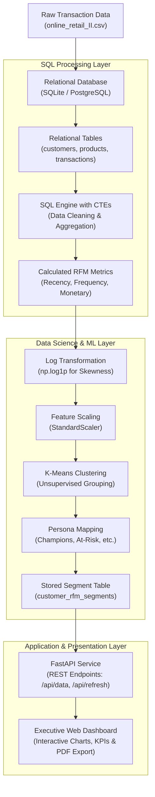

# 🛒 E-Commerce RFM Customer Segmentation & Targeting

[](https://www.python.org/)
[](https://fastapi.tiangolo.com/)
[](https://www.sqlite.org/)
[](https://scikit-learn.org/)
[](LICENSE)

An end-to-end data analytics and machine learning solution that segments e-commerce customers using **RFM Analysis (Recency, Frequency, Monetary)** combined with **unsupervised machine learning (K-Means Clustering)**. The system ingests raw transaction logs, extracts customer metrics using SQL, scales and clusters behaviors with Scikit-Learn, and serves an executive dashboard via FastAPI.

> [!NOTE]
> **Attribution**: The frontend dashboard webpage (`index.html`) was designed and generated by **Google Gemini** (and not by the project author).

---

## 📌 Table of Contents

- [Overview & The Concept](#-overview--the-concept)
- [System Architecture](#-system-architecture)
- [Core Engineering Roles](#-core-engineering-roles)
  - [1. The SQL Role](#1-the-sql-role)
  - [2. The Data Science Role](#2-the-data-science-role)
  - [3. The Application & API Role](#3-the-application--api-role)
- [Customer Personas & Marketing Playbook](#-customer-personas--marketing-playbook)
- [Project Structure](#-project-structure)
- [Getting Started](#-getting-started)
  - [Prerequisites](#prerequisites)
  - [Installation](#installation)
  - [Running the Application](#running-the-application)
- [API Reference](#-api-reference)
- [SQL RFM Calculation (Reference)](#-sql-rfm-calculation-reference)
- [Dashboard Features](#-dashboard-features)
- [Acknowledgments & Attribution](#-acknowledgments--attribution)
- [License](#-license)

---

## 💡 Overview & The Concept

In modern e-commerce, a one-size-fits-all marketing strategy leads to inefficient ad spend, poor retention, and high churn rates. This project identifies behavioral groups across transactional history through **RFM Analysis**:

- **Recency ($R$)**: How many days have elapsed since the customer's last order?
- **Frequency ($F$)**: How many distinct orders has the customer placed?
- **Monetary ($M$)**: How much total revenue has the customer generated?

By combining SQL-based transactional processing with unsupervised clustering, the platform assigns customer personas (such as **Champions**, **Potential Loyalists**, **At-Risk**, and **Lost Customers**) to enable automated, personalized retention campaigns and executive financial oversight.

---

## 🏛 System Architecture



---

## 🛠 Core Engineering Roles

### 1. The SQL Role
- **Relational Modeling & Ingestion**: Normalizes raw transaction records into a 3NF schema containing `customers`, `products`, and `transactions` tables with primary/foreign key constraints and index support.
- **Complex Aggregations with CTEs**: Executes multi-stage Common Table Expressions (CTEs) to filter invalid entries (e.g., cancelled invoices prefixed with `'C'`, negative quantities, zero-monetary items).
- **Date Arithmetic & Window Operations**: Computes recency using Julian day differences relative to dataset cutoff dates, calculates lifetime frequency via distinct order counts, and computes total spend.
- **Persistence**: Writes aggregated customer profiles to indexed tables ready for modeling.

### 2. The Data Science Role
- **Distribution Normalization**: Financial and e-commerce data exhibits heavy right-skewed distributions. Applies `np.log1p()` transformation to stabilize variance across $R$, $F$, and $M$.
- **Standardization**: Applies `StandardScaler` to ensure zero mean and unit variance across metrics.
- **Clustering (K-Means / Hierarchical)**: Uses optimal cluster selection evaluated through silhouette scores and elbow analysis to partition the customer base into distinct behavioral cohorts.
- **Persona Mapping**: Translates raw cluster centroids into actionable marketing segments:
  - **Champions**: High monetary value, high purchase frequency, low recency.
  - **Potential Loyalists**: Recent shoppers with moderate frequency and growing spend.
  - **At-Risk**: High past spend or frequency, but high recency (dormant period).
  - **Lost Customers**: Highest recency, lowest frequency, and minimal revenue.
- **Executive KPIs**: Computes portfolio-level metrics including Total Revenue, Average Order Value (AOV), Customer Count, and Churn Risk Percentage.

### 3. The Application & API Role
- Built with **FastAPI** for asynchronous, high-throughput delivery.
- Self-contained lifespan handlers ensure database tables and RFM segmentations are initialized at boot.
- Supports **on-demand re-syncing** via `/api/refresh` to re-ingest CSV files, re-run ML pipelines, and update segments.
- Single-page executive interface rendered with vanilla modern CSS and **Chart.js** (no bloated front-end dependencies).

---

## 👥 Customer Personas & Marketing Playbook

| Persona | Behavioral Profile | Marketing Strategy |
| :--- | :--- | :--- |
| 🏆 **Champions** | Recent purchases, frequent orders, highest total spend. | Reward with VIP perks, early product access, loyalty rewards, and brand ambassador programs. |
| 📈 **Potential Loyalists** | Recent buyers with above-average spend and moderate order frequency. | Upsell higher-margin products, offer tiered bundle discounts, and encourage newsletter signups. |
| ⚠️ **At-Risk** | Formerly frequent or high-value spenders who have not purchased recently. | Send personalized win-back emails, limited-time reactivation discounts, and feedback surveys. |
| 💤 **Lost Customers** | Very high recency (long inactivity), low order count, low spend. | Run automated low-cost reactivation campaigns; exclude from high-cost direct marketing channels. |

---

## 📂 Project Structure

```text
rfm_segmentation/
│
├── data/
│   └── online_retail_II.csv       # Raw e-commerce transaction dataset
│
├── src/
│   ├── __init__.py
│   ├── sql_handler.py             # DDL, ETL ingestion, and SQL CTE RFM queries
│   └── analysis.py                # ML pipeline (log-transform, scaling, KMeans, personas)
│
├── ecommerce.db                   # SQLite database (auto-generated on startup)
├── index.html                     # Executive analytics frontend dashboard
├── main.py                        # FastAPI application server and API routes
├── requirements.txt               # Python package dependencies
├── .gitignore                     # Git ignore rules
└── README.md                      # Project documentation
```

---

## 🚀 Getting Started

### Prerequisites

- **Python 3.10+** installed
- Git installed (optional, for version control)

### Installation

1. **Clone or navigate to the repository:**
   ```bash
   cd rfm_segmentation
   ```

2. **Create and activate a virtual environment:**
   ```bash
   # Windows (PowerShell)
   python -m venv venv
   .\venv\Scripts\Activate.ps1

   # Linux / macOS
   python3 -m venv venv
   source venv/bin/activate
   ```

3. **Install dependencies:**
   ```bash
   pip install -r requirements.txt
   ```

### Running the Application

1. **Launch the FastAPI server:**
   ```bash
   python main.py
   ```
   *Or with Uvicorn directly:*
   ```bash
   uvicorn main:app --host 127.0.0.1 --port 8000 --reload
   ```

2. **Access the Dashboard:**
   Open your browser and navigate to:
   ```text
   http://127.0.0.1:8000
   ```

---

## 🔌 API Reference

### 1. Web Dashboard
- **`GET /`**
  - Serves the standalone interactive executive dashboard (`index.html`).

### 2. Fetch Segmentation & KPI Payload
- **`GET /api/data`**
  - Returns the latest calculated KPIs, segment breakdowns, and top country metrics.
  - **Sample Response:**
    ```json
    {
      "kpis": {
        "total_customers": 4312,
        "total_revenue": 8853826.19,
        "average_order_value": 460.11,
        "churn_risk_percentage": 37.45
      },
      "segment_summary": [
        {
          "segment": "Champions",
          "customer_count": 1280,
          "total_revenue": 5240100.50,
          "avg_recency": 14.2,
          "avg_frequency": 8.4,
          "avg_monetary": 4093.82
        }
      ],
      "geo_data": [
        {
          "country": "United Kingdom",
          "segment": "Champions",
          "revenue": 4650320.10,
          "customers": 1120
        }
      ]
    }
    ```

### 3. Trigger Data Refresh
- **`POST /api/refresh`** or **`GET /api/refresh`**
  - Rescans the source CSV file, updates SQLite tables, recalculates K-Means clustering, and returns refreshed metrics.

---

## 📊 SQL RFM Calculation (Reference)

The underlying SQL query executed by the handler uses Common Table Expressions (CTEs) to clean records and aggregate customer features:

```sql
WITH cleaned_transactions AS (
    SELECT
        t.customer_id,
        c.country,
        t.invoice_no,
        t.invoice_date,
        (t.quantity * t.unit_price) AS line_total
    FROM transactions t
    INNER JOIN customers c
        ON t.customer_id = c.customer_id
    WHERE t.invoice_no NOT LIKE 'C%'  -- Exclude cancellations
      AND t.quantity > 0               -- Exclude returns/adjustments
),

customer_rfm AS (
    SELECT
        customer_id,
        country,
        -- Recency: Days elapsed between latest dataset timestamp and customer's last purchase
        CAST(
            julianday((SELECT MAX(invoice_date) FROM transactions)) - julianday(MAX(invoice_date)) 
            AS INTEGER
        ) AS recency_days,

        -- Frequency: Count of distinct purchase transactions
        COUNT(DISTINCT invoice_no) AS frequency,
        
        -- Monetary: Total spend across all purchases
        SUM(line_total) AS monetary_value
    FROM cleaned_transactions
    GROUP BY customer_id, country
)

SELECT *
FROM customer_rfm
WHERE monetary_value > 0;
```

---

## 🖥 Dashboard Features

- **Executive KPI Cards**: Instant visibility into Total Portfolio Revenue, Active Customers, Average Order Value (AOV), and Churn Risk Percentage.
- **Segment Donut Chart**: Distribution of customer count across segments.
- **Revenue Contribution Chart**: Direct comparison of revenue generated by each persona.
- **Geographic Stacked Bar Chart**: Country-by-country breakdown of segments for the top revenue markets.
- **Segment Summary Matrix**: Comprehensive breakdown of average recency, order frequencies, and monetary benchmarks.
- **Interactive Country Filter**: Searchable and filterable data table for market-level performance analysis.
- **One-Click PDF Export**: Integrated print and document export functionality using `html2pdf.js`.

---

## 📑 Acknowledgments & Attribution

- **Frontend Interface**: The interactive dashboard webpage (`index.html`) was generated by **Google Gemini**, not authored manually by the project maintainer.
- **Dataset**: E-commerce transactional records based on the publicly available Online Retail II dataset.

---

## 📄 License

This project is licensed under the MIT License — see the [LICENSE](LICENSE) file for details.
